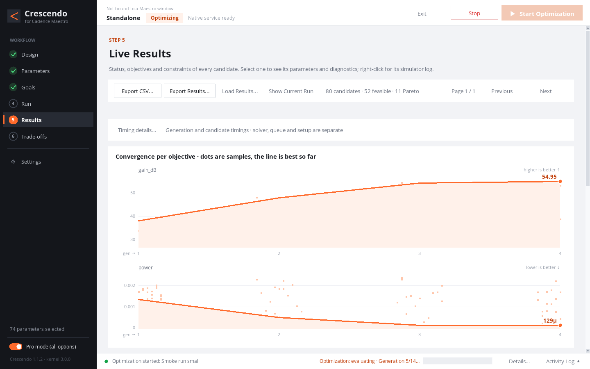

# Crescendo

[中文说明](README.zh-CN.md)

Crescendo is a guided circuit optimizer that runs inside Cadence Maestro. Pick the device parameters it may tune, state what "better" means, and it simulates, compares and converges on the best designs and the Pareto front for you. Your original design stays read-only throughout.



## What it does

- **Six-step workflow**: Design → Parameters → Goals → Run → Results → Trade-offs, shown as the left-hand navigation with a tick for each finished step.
- **Simple and Pro modes**: the default view keeps only the main flow. Pro mode adds private suites, history, optional PDK range checks, algorithm parameters, run/submit commands, EDA overrides and three-stage link diagnostics. Switching modes changes what is shown, never the settings.
- **Search**: NSGA-II (automatic for two or more objectives), differential evolution and Bayesian optimization; per-corner objectives and constraints with `max` / `mean` aggregation.
- **Execution**: Spectre or ALPS, locally or on a batch cluster; a private copy of the Maestro setup is used for every run, and a checkpoint is written after every candidate so runs can be stopped and resumed.
- **Live results**: KPI tiles, best-so-far convergence per objective, a candidate table, Pareto plots that jump to a candidate on click, CSV and full-dataset export.
- **Large projects**: on a synthetic project with 4,000 blocks and 50,726 parameters the parameter tree renders without freezing the window for more than 74 ms.

## Requirements

- Python 3.6 or newer (standard library only) with Tk 8.5 or newer, and an X display. No pip packages, no virtualenv.
- For real optimization: your own Cadence Virtuoso (IC 6.1.8 tested) with Maestro and Ocean, Spectre or ALPS, your PDK and your licences. A batch cluster is optional.
- The demo mode needs none of the EDA tools.

## Quick start (no EDA tools needed)

```bash
git clone <this repository> crescendo
cd crescendo
python3 -m crescendo.demo_main --scale small --autoload
```

The demo service generates synthetic op-amp-like metrics (a seeded, analytic two-objective front). It never calls Cadence. `--scale large` and `--scale huge` create bigger projects (up to 4,000 blocks / ~50,000 parameters) for responsiveness checks.

## Using with Cadence

1. Unpack the release somewhere on the machine that runs Virtuoso.
2. Add one line to the `.cdsinit` your project loads (back it up first):

   ```lisp
   load("/path/to/crescendo/load.il")
   ```

   Optionally point the engine at your model root before that line: `setShellEnvVar("PDK=/path/to/model_root")`.
3. Restart Virtuoso and open **Maestro → Plug-in → Open Crescendo Optimizer** (or the **Crescendo** menu when the Plug-in menu is unavailable).

Crescendo reads the Maestro window it was opened from. Tools, model directories and simulators are detected from that window's environment and can be overridden in **Settings → EDA** (Pro mode).

Cluster execution uses **Settings → EDA → Solver / Submission Commands** (Pro mode),
or `runtime.execution_commands` in JSON. `submission_template` is the complete
submit command and includes `{job_script}`; `scheduler_query_template` and
`scheduler_cancel_template` each include exactly one `{job_id}`. All three are
literal argv templates: quote arguments before placeholder expansion; use an
executable wrapper for shell logic. No scheduler executable or option is inferred.
For example (replace these illustrative commands with your own wrappers):

```json
{
  "runtime": {
    "execution_commands": {
      "submission_template": "batch-submit --cwd {cwd} --stdout {scheduler_stdout} --stderr {scheduler_stderr} {job_script}",
      "scheduler_query_template": "batch-query {job_id}",
      "scheduler_cancel_template": "batch-cancel {job_id}"
    }
  }
}
```

Query/cancel templates may also bind `{cwd}`, `{job_script}`, `{test}`, `{corner}`,
`{point_id}`, `{threads}`, `{scheduler_stdout}` and `{scheduler_stderr}` from the
owned task. Standalone diagnostic queries have `{cwd}` and available task metadata;
use a wrapper with a self-contained Job ID interface when other bindings are unavailable.
The two log placeholders allocate private per-task paths; your submit wrapper must
route the scheduler's output there. Missing query or cancel templates block Cluster
preparation; Local execution needs neither. `command_scheduler` accepts `auto`
(track when templates are configured), `batch` (explicit tracking), or `receipt`
(an opaque wrapper whose owned completion receipt supplies completion evidence).
Cluster preparation requires both templates in every mode.
An explicit `-R "cpu=N;..."` resource argument, if supplied, must agree with solver
threads; other scheduler resource syntaxes belong in your wrapper.

The **scheduler key-value protocol** lets any scheduler integrate through a query
wrapper. On a successful exact-job query it must emit one numeric `JOB_ID` matching
`{job_id}` and one `JOB_STATE`, separated from values by whitespace, `:` or `=`.
For example:

```text
JOB_ID 10000001
JOB_STATE RUNNING
EXIT_CODE -
EXEC_NODE node01
```

`EXIT_CODE` is optional (an integer when available; `-` while unavailable).
Optional metadata includes `EXEC_NODE`, `SUBMIT_NODE`, `JOB_NAME`, `QUEUE`,
`ACCOUNT`, `REQ_CPU`, `REQ_MEM`, `JOB_CREATE_TIME` and `EXIT_MESSAGE`.
Active states include `PENDING`, `QUEUED`, `RUNNING`, `SUSPENDED` and `COMPLETING`;
terminal states include `SUCCEEDED`, `SUCCESS`, `DONE`, `FINISHED`, `FAILED`, `EXIT`,
`TERMINATED`, `CANCELLED` and `CANCELED`. JSON and a `JOB_ID JOB_STATE` table are also
accepted. Optional `TASK[n].STATE` records must all be terminal for a terminal job.
Conflicting states, foreign IDs, unknown states, failed commands and job disappearance
never prove that a job stopped. Cancellation acknowledgement alone is insufficient;
Crescendo polls the owned ID within its stop deadline. Simulator success separately
requires the owned receipt and result evidence.

Submit wrappers return a unique `JOB_ID: 10000001`, a JSON `jobId`, a `JOBID MESSAGE` table,
or an explicit `Submitted batch job 10000001` acknowledgement. Scheduler task logs
may contain `TASK_INFO` records with the exact owned Job ID; these provide bounded
log evidence and never authorize completion by themselves.

## CLI for agents

All commands run from the repository root:

```bash
python3 -m crescendo --version                 # Crescendo and engine versions
python3 -m crescendo doctor                    # JSON environment report
python3 -m crescendo gui                       # open the window (standalone)
python3 -m crescendo run optimization-spec.json  # headless optimization run
python3 -m crescendo resume <checkpoint>       # resume a stopped run
python3 -m crescendo parse-rdb <path>          # read a Maestro results database as JSON
cadence/crescendo_launch --check               # JSON launch preflight (Python/Tk discovery)
python3 -m crescendo.demo_smoke --scales small large   # scripted end-to-end demo, prints timings
python3 scripts/run_tests.py                   # engine test suite
```

## Limitations

- Optimization quality and runtime depend on your simulator, models and Maestro setup; the demo numbers are synthetic and say nothing about real circuits.
- Crescendo does not write the optimized values back into your original schematic. Results, netlists and parameter evidence are kept per run.
- Global and local design variables must each hold a single value; multi-value sweeps belong in corners.
- Range checks are optional and only verify the end points of each range.
- Real-site acceptance (your ALPS/batch scheduler setup, your PDK) is yours to run; this repository is tested locally with synthetic fixtures.

## RF-FIELDWORK

Product page: https://rf-fieldwork.pages.dev/crescendo/?lang=en

Other open-source tools:

- [Flux Studio](https://github.com/chloeyntu-byte/flux-studio): parametric RF passives, EMX sweeps, multi-objective search and SNPFit
- [Cap Array Lab](https://github.com/chloeyntu-byte/cap-array-lab): capacitor-array C/Q, parasitic paths, resonance and Z11
- [Layout 3D Viewer](https://github.com/chloeyntu-byte/layout-3d-viewer): read IC layouts in 3D, locate pins and trace connections
- [VCO ISF Explorer](https://github.com/chloeyntu-byte/vco-isf-explorer): ISF, flicker-noise up-conversion and phase-noise contributions

## License

MIT, see [LICENSE](LICENSE).

