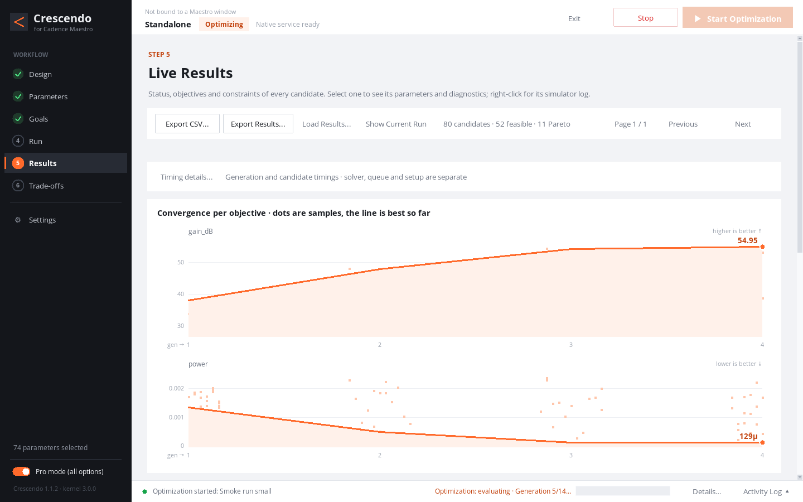

# Crescendo

[English](README.md)

Crescendo 是运行在 Cadence Maestro 里的引导式电路优化器。勾选它可以调的器件参数、写下什么叫“更好”，它会自动仿真、比较，收敛到最优设计和 Pareto 前沿。原设计全程只读。



## 能做什么

- **六步流程**：Design → Parameters → Goals → Run → Results → Trade-offs，就是左侧导航，完成一步打一个勾。
- **简洁 / 专业两种模式**：默认只显示主流程；Pro mode 打开工作副本、历史结果、可选的 PDK 范围检查、算法参数、执行与提交命令、EDA 覆盖和三级链路诊断。切换只改显示，不改设置。
- **搜索算法**：NSGA-II（两个及以上目标时自动使用）、差分进化、贝叶斯优化；目标和约束可按角点选择，支持 `max` / `mean` 聚合。
- **执行**：Spectre 或 ALPS，本地或批处理集群；每轮使用 Maestro 工作副本，每个候选完成后写断点，可停止后续跑。
- **实时结果**：指标卡、每个目标的历代最优收敛曲线、候选表、点击即跳转的 Pareto 图，可导出 CSV 和完整数据集。**Timing details...** 展示每代与选中候选的分阶段耗时；求解器证据、覆盖率和并行边界见[执行计时指南](docs/EXECUTION_TIMING.md)。
- **大工程**：在 4000 个模块、50,726 个参数的合成工程上，参数树渲染期间界面最长无响应 74 ms。

## 环境要求

- Python 3.6 及以上（只用标准库）、Tk 8.5 及以上，以及 X 显示。不需要 pip 包或虚拟环境。
- 真实优化需要你自己的 Cadence Virtuoso（已在 IC 6.1.8 上测试）、Maestro 与 Ocean、Spectre 或 ALPS、你的 PDK 和 license。批处理集群可选。
- 演示模式不需要任何 EDA 工具。

## 快速开始（无需 EDA）

```bash
git clone <本仓库> crescendo
cd crescendo
python3 -m crescendo.demo_main --scale small --autoload
```

演示服务生成合成的运放式指标（带固定种子的解析双目标前沿），不调用 Cadence。`--scale large`、`--scale huge` 会生成更大的工程（最多 4000 个模块、约 5 万个参数），用于检查界面响应。

## 在 Cadence 中使用

1. 把发布包解压到运行 Virtuoso 的机器上。
2. 在项目实际加载的 `.cdsinit` 里（先备份）加一行：

   ```lisp
   load("/path/to/crescendo/load.il")
   ```

   如需指定模型根目录，可在这行之前加 `setShellEnvVar("PDK=/path/to/model_root")`。
3. 重启 Virtuoso，在 **Maestro → Plug-in → Open Crescendo Optimizer** 打开（没有 Plug-in 菜单时用顶部 **Crescendo** 菜单）。

Crescendo 读取打开它的那个 Maestro 窗口。工具、模型目录和仿真器从该窗口的环境自动识别，也可以在 **Settings → EDA**（Pro mode）中覆盖。

三种执行模式分别说明网表与求解由谁完成：

| 模式 | 执行方式 |
| --- | --- |
| **原生运行（Native Run）** | Maestro 自己仿真，Crescendo 设置参数并读取结果。 |
| **Maestro 网表（Maestro Netlist）** | Maestro 生成网表，由 Crescendo 的求解池按配置上限并行求解。 |
| **模板网表（Template Netlist）** | Crescendo 在合格模板中改参并求解；符合回退条件时改由 Maestro 生成。 |

Pro 执行设置还提供以下资源控制；新运行会冻结这些值：

| 设置 | 默认值 | 含义 |
| --- | --- | --- |
| `native_candidate_batching` | 新配置为 `generation` | 每代一次原生分组运行；`serial` 逐候选运行。缺少此键的已有配置和旧 checkpoint 保持串行。模板网表模式仍直接实例化模板。 |
| `local_solver_max_jobs` | `1` | 显式设置 Local 求解槽位，实际并发同时受 Global 和 Test 限制。 |
| `measurement_jobs` | `null`，自动取 `min(2, G)` | 本机 reader worker 数；显式值受 Global 容量 `G` 限制。 |
| `progress_flush_interval_seconds` | `0.5` | 显示快照的最短写入间隔；终态、ownership 和 checkpoint ACK 仍立即持久化。 |

这些控件只在 Pro 模式显示。详见[原生分组](docs/NATIVE_BATCHING.md)和[执行计时](docs/EXECUTION_TIMING.md)。

集群模式在 Pro 模式的 EDA 执行设置或 `runtime.execution_commands` 中配置三条 argv 模板：
`submission_template` 必须包含 `{job_script}`，`scheduler_query_template`、
`scheduler_cancel_template` 各包含一个 `{job_id}`。查询或取消模板为空会阻断集群准备；
本地执行无需这些模板。无默认调度器路径，也不推断选项；复杂逻辑请放到用户包装脚本中。
例如 `batch-submit {job_script}`、`batch-query {job_id}`、`batch-cancel {job_id}` 仅为示意。
提交日志可用 `{scheduler_stdout}` / `{scheduler_stderr}` 绑定到独立任务路径。

通用“调度器键值协议”：查询成功时输出当前作业的 `JOB_ID`（纯数字）和 `JOB_STATE`，
键值以空白、冒号或等号分隔。可选 `EXIT_CODE`（整数或 `-`）、`EXEC_NODE`（如 `node01`）、
`SUBMIT_NODE`、`JOB_NAME`、`QUEUE`、`ACCOUNT`、`REQ_CPU`、`REQ_MEM`、`JOB_CREATE_TIME`、`EXIT_MESSAGE`。
例如 `JOB_ID 10000001` 和 `JOB_STATE RUNNING` 各占一行。支持 JSON 和表格形式；
`TASK[n].STATE` 存在时必须全部终止才可证明作业终止。冲突、其他作业号、消失、查询失败和
取消确认均不能证明停止。求解成功仍需本次任务的回执和结果证据。完整模板、状态及提交输出示例见英文说明。

## Crescendo 会创建什么

原始 schematic 和 Maestro 视图全程只读。Crescendo 只在工作副本上写入参数与运行设置，不把优化值写回原设计。

| 内容 | 位置与用途 |
| --- | --- |
| 工作视图 | 在原库的各个源 cell 下创建：所选 setup 的 Maestro 副本、所选设计的 config 副本，以及按层级实例区分的工作 schematic。未修改的引用保持只读。名称为 `cr_s_<token8>_<label>_<role>_<hash10>`，依次包含会话 token 前 8 位、规范化的优化名称（最多 32 字符）、角色和身份哈希。每个视图有 `.crescendo-owned-view.json` 归属标记，并与会话登记表核对。 |
| 项目状态 | `<项目>/.crescendo/<TB>__<library>_<view>_<hash>/`：`states/` 保存界面和配置状态，`index.json` 为设计索引，`cache/` 存放探测缓存。有效元数据目录记录在 `runtime.design_root` 中。`setup_private_sessions/<session-id>/` 保存工作副本的归属、检查快照、配置和 workspace 记录，位于 `runtime.design_root` 下；未配置设计根目录时使用 `runtime.run_root`。 |
| 运行结果 | 通常为 `<数据根>/crescendo/<设计命名空间>/<优化名称>__<时间戳>_<token>/`。数据根继承所选 Maestro 的 Save Options（首次发现不可用时回退到 `<项目>/simulation`），可在 **Data Root Override**（`runtime.data_root_override`）更改。选择设计前，独立启动的默认运行父目录是 `<项目>/.crescendo/runs`。选择设计后的根目录覆盖规则见下文。重新加载 setup 后若不能确认保存路径，真实运行前必须明确选择数据根目录。 |
| 断点与日志 | 每轮保存 `checkpoint.json`、增量数据集 `optimization.crescendo`、结果/状态、计时证据和 `crescendo.log`。续跑或导出时请一起保留。原生 history 位于工作副本 workspace 的 `simulation/` 下，`_scratch/` 用于本地 PSF/RDB 暂存。 |
| 临时文件 | 启动和浏览探测通常位于设计目录的 `cache/probes/`；少量启动文件使用系统临时目录（`TMPDIR`，通常 `/tmp`）。已登记的临时目录带 `.cr_scratch_owner.json` 回执，默认预算为 128 MiB（`runtime.local_scratch_budget_bytes`）。仿真数据保存在配置的数据目录。 |

**根目录覆盖规则。** 界面加载含 `runtime.run_root: <base>` 的配置后，选择设计会将元数据放在 `<base>/<设计命名空间>/`，运行放在 `<base>/<设计命名空间>/runs/<运行名称>/`。相对 `<base>` 以配置文件所在目录为基准。`CRESCENDO_RUN_ROOT` 优先于配置项，相对路径以启动工作目录为基准，同样按设计分目录。加载器把这个基目录记录为 `runtime.storage_base_override`；选择设计后，有效的 `runtime.design_root` 和 `runtime.run_root` 指向上述分目录。**Data Root Override** 优先决定仿真结果位置，使用 `<数据根>/crescendo/<设计命名空间>/<运行名称>/`，元数据仍在选定位置。底层存储策略 API 的 `runtime.run_root_override` 只有在未启用命名空间覆盖时才直接指定运行父目录，与界面加载配置的流程不同。更换根目录会选择新的存储位置；旧运行与视图退役前，请保留旧结果和工作副本登记表。

**创建与复用。** **Load and Inspect** 创建 Maestro/config 工作副本；**Apply Selected Cells** 建立并绑定所选层级的工作 schematic。候选和各代借用、重置同一个副本，不为每个候选复制整个库。Pro 模式的 **Design → Working Copies → Manage / Load Working Copies…** 列出已保存副本及成员路径，支持加载、分项更新、改名、恢复和删除。**Settings → Maestro Working Copy** 显示继承的原生设置；**Open Config** 可查看绑定。

**完成、停止与退出。** 完成的候选先写入数据集和断点，再清理符合条件的 CLI 原始工作目录。共享 CLI 清理等待所有逻辑候选提交完成；中断的等待在 Resume 时核对。原生运行也在断点提交后释放共享 history 的使用引用，但保留原生 history/PSF 证据；释放引用不等于删除 history。网表准备证据也保留。Stop 先停止所属任务并证明终止，远端状态不明时阻止清理和续跑。正常退出停止活动任务、释放工作副本租约，并清理已证明安全的临时目录和暂存日志；已保存的工作视图及登记表保留供下次复用。运行完成或 Stop 都不会删除所有工作副本。

**异常后恢复。** 下次打开列表会读取持久化归属与会话记录，检查租约、视图标记、快照和未完成事务。加载或 **Resume** 在重新提交前核对原有原生/CLI 任务；窗口或作业消失不等于已终止。创建/刷新未完成、归属证据缺失或变化、编辑器/锁仍占用、停止未证实等情况，会保留或隔离副本并阻止复用/删除。列表提供恢复操作时，先查看警告再操作；恢复可能保留备份和被替换的视图作为证据。**Retry Exit** 重试未完成的退出清理；**Close Window Only** 保留未决任务并隔离对应副本，不确认远端已停止。

**磁盘与手动清理。** 先 Stop 并关闭该副本的 Maestro/config/schematic 编辑器，优先使用列表中的 **Delete**，在确认框中核对所选副本；它核对登记表、标记和写入进程终止证据。不要只按 `cr_s_` 前缀批量删除，不要删除原生锁，也不要在视图仍存在时删掉登记表。原始候选清理依赖安全证据，没有按天数或总容量自动淘汰的承诺；原生 history、失败/未决证据和已保存副本可能持续占用空间。先导出或归档结果。确认全部所属任务及 reader 已停止、且不再需要 Resume 后，才可删除整轮废弃运行目录；断点、结果与诊断会一起丢失。工作副本元数据须保留到管理器删除其视图后。残留临时目录只在归属回执和生产进程停止证据完整时清理，不扫描删除无关临时目录。

## 给 agent 的命令行

在仓库根目录运行：

```bash
python3 -m crescendo --version                 # Crescendo 与引擎版本
python3 -m crescendo doctor                    # JSON 环境报告
python3 -m crescendo gui                       # 打开窗口（独立模式）
python3 -m crescendo run optimization-spec.json  # 无界面优化
python3 -m crescendo resume <checkpoint>       # 续跑已停止的运行
python3 -m crescendo parse-rdb <path>          # 把 Maestro 结果库读成 JSON
cadence/crescendo_launch --check               # JSON 启动预检（Python/Tk 探测）
python3 -m crescendo.demo_smoke --scales small large   # 脚本化端到端演示，输出耗时
python3 scripts/run_tests.py                   # 引擎测试
```

## 作为库调用优化器

只需要搜索算法的工具，可以直接 import `crescendo_engine.optimizers`，用 ask/tell 调用，不需要窗口、Maestro 或调度器。见 [无界面优化器接口](docs/HEADLESS_API.md)（英文）；请固定使用已发布的版本，不要直接引用开发中的代码。

## 限制

- 优化效果和耗时取决于你的仿真器、模型和 Maestro 设置；演示数据是合成的，不代表任何真实电路。
- Crescendo 不会把优化值写回你的原始原理图；每轮保留结果、网表和参数证据。
- Global 与 Local 设计变量各自只能是单值，需要多值扫描时放在角点里。
- 范围检查是可选的，只核对每个范围的两个端点。
- 真实站点（你的 ALPS/批处理集群环境、你的 PDK）的验收需要你自己完成；本仓库只在本机用合成夹具测试。

## RF-FIELDWORK

产品介绍页：https://rf-fieldwork.pages.dev/crescendo/?lang=zh（含配音演示片的工具在页面上可直接观看）

其他开源工具：

- [Flux Studio](https://github.com/chloeyntu-byte/flux-studio)：参数化射频无源器件、EMX 扫参、多目标优化与 SNPFit 拟合
- [Cap Array Lab](https://github.com/chloeyntu-byte/cap-array-lab)：电容阵列 C/Q、寄生路径、谐振与 Z11
- [Layout 3D Viewer](https://github.com/chloeyntu-byte/layout-3d-viewer)：三维阅读版图、定位 pin、追踪连接
- [VCO ISF Explorer](https://github.com/chloeyntu-byte/vco-isf-explorer)：ISF、闪烁噪声上变频与相噪贡献
- [VCO Design Studio](https://github.com/chloeyntu-byte/vco-design-studio)：五类文献 LC VCO 拓扑、分层原理图与原生导出

## 许可

MIT，见 [LICENSE](LICENSE)。

