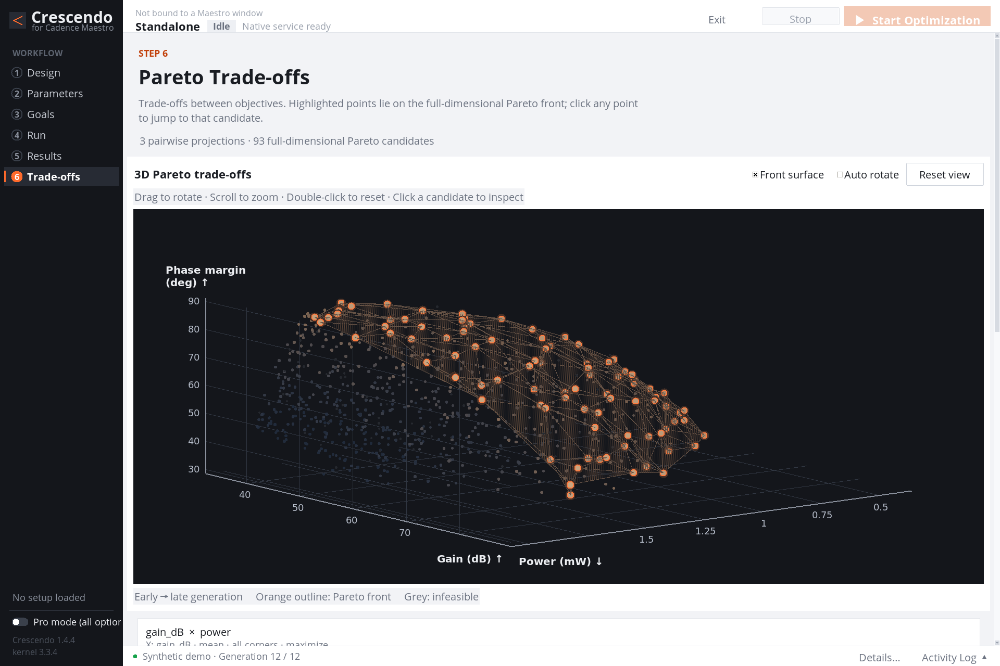

# Three-objective Pareto view

Exactly three objectives add an interactive 3D card above the existing pairwise
projections in both Simple and Pro modes. Two-objective and four-or-more-objective
views retain their existing layouts. The view uses only Tk Canvas (Python 3.6,
Tk 8.5); no OpenGL, plotting package, browser or native extension is required.



Drag to rotate, scroll to zoom, double-click or use **Reset view** to restore the
camera. Arrow keys rotate the focused canvas; Home resets it. **Auto rotate** is
off by default and pauses when the view is hidden or being dragged. Clicking a
point uses the same candidate-details and persistence eligibility path as a 2D
point. Loaded synthetic data remains read-only. **Front surface** (on by default)
adds a translucent, depth-sorted Delaunay mesh of feasible front samples. The
mesh uses a normalized objective plane and caps its vertices at 220; points
are never dropped from the front itself. Long bridges and degenerate triangles
are omitted. Tk 8.5 uses stippled transparency. This is a visual guide between
observations, not a model of feasibility or an optimizer result.

The default yaw 0.92 / pitch 0.48 reveals the curved front shell, matching the
side-facing reference capture. Reset and Home restore this camera and unit zoom.
At unit zoom the box spans 83% of canvas width and 81% of height. The orthographic
projection uses separate viewport scales to fill wide and narrow canvases; screen
angles and lengths are illustrative, while tick values carry physical units.
Window resizing and rotation both recompute the fit. Titles follow axis endpoints;
conflicting ticks are omitted using measured text extents. Data bounds use 6.5%
padding per side, with nice tick intervals and matching grid lines.

Axes show actual objective values and the objective name with its direction.
Cool blue to warm peach colors encode generation; orange outlines mark the full-dimensional
Pareto front and grey marks infeasible candidates. Points are sorted by depth,
with distant points smaller and dimmer. Rotation updates existing items' coordinates,
colors and stacking order; it does not recreate them. The soft display budget is
1,600 points: non-front points are sampled deterministically, all Pareto points
are retained, and a notice reports sampling. An archive with more than 1,600
Pareto points can exceed this budget to avoid hiding trade-offs.

## Synthetic demo

```bash
python3 -m crescendo.demo_main --three-objective --auto-rotate
```

The original demo (without `--three-objective`) keeps its existing behavior and
16-candidate default. The three-objective replay defaults to 12 generations of
64 candidates. `--seed`, `--generations`, `--population` and `--speed` control the
replay. It uses gain (maximize), power in mW (minimize), and phase margin (maximize).
Two independent design coordinates span a curved surface. Early generations spread over the dominated interior; later generations form
a narrow shell near the ideal surface; feasibility and true cumulative Pareto membership are
computed deterministically. It is illustrative synthetic data, not circuit
simulation or a claim about optimizer convergence.

## HD screenshots and web data

On an owned X11 display of at least 1920 × 1280 pixels:

```bash
python3 -m crescendo.demo_main --export-3d ./pareto-media --frames 48
```

This opens the actual Crescendo window at Tk scaling 2.0 and captures its mapped
widgets through X11. Standard-library PNG encoding needs no screenshot package
or encoder installation. Keep the window unobscured during capture. The exporter
creates:

- `pareto-3d-ui.png`: the complete 1920 × 1280 application window.
- `rotation-000.png` … `rotation-047.png`: one full turn of the actual 3D card,
  uniformly spaced at 360/N degrees, suitable for looping without a duplicate end frame.
- `generation-000.png` … `generation-011.png`: the same card as the archive grows.
- `pareto-3d-hero.png`: a 1920 × 1080 canvas without app controls or chrome.
- `pareto-3d.json`: compact, versioned synthetic data (under 300 KB by default).

The JSON stores each candidate once in `candidates`, with `candidate_id`,
`generation`, the three numeric `values` (ordered as `objectives`), `feasible`,
and `pareto` (membership at the end of its birth generation). Each `frames` entry
contains `generation` and the cumulative `pareto_ids` at that generation. To
repaint frame G, include candidates whose generation is <= G and mark the IDs
from that frame. A candidate's front membership can change in later frames;
never use the birth-generation `pareto` flag to color subsequent frames.
`objectives` supplies names, units in names, keys and optimization directions.
Each frame also includes `front_triangles`: triples of zero-based indices into
`candidates`, referencing only feasible current-front vertices. The `surface`
object declares this additive v1 contract, vertex cap and triangulation method.
Use these triangles directly in a web renderer; sort faces by camera-space depth
on each rotation. `camera` supplies default yaw/pitch/zoom and viewport fractions.
`axis_bounds` keeps the same scale across generations so improvement remains
visible. The document records `synthetic: true`, the seed and a schema identifier.

The export leaves ordinary settings untouched; temporary demo settings are
isolated under the requested output directory and removed when capture ends.
